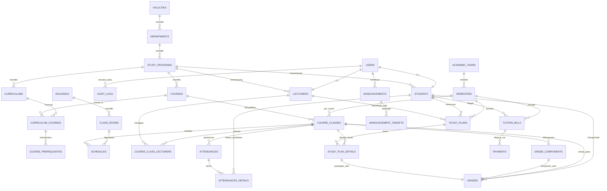

# DATABASE DESIGN — SIMORA

> Versi: 1.0 — Tanggal: 2026-11-02
> Engine: PostgreSQL 18 · Laravel 13 Migrations
> Konvensi: snake_case, `id` BIGSERIAL (PK), `created_at` / `updated_at`, soft delete (`deleted_at`) hanya pada tabel entitas utama & data historis.

---

## 1. Prinsip Desain

- **Primary key**: semua tabel memakai `id` BIGSERIAL, kecuali tabel bawaan spatie/laravel-permission.
- **Foreign key**: didefinisikan eksplisit; `cascadeOnDelete` untuk relasi anak yang bergantung penuh pada induknya, `nullOnDelete` untuk referensi opsional.
- **Unique constraint**: composite, sesuai konteks (daftar di §3).
- **Index**: kolom yang sering dipakai filter/search/sort (`code`, `name`, `status`, `study_program_id`, `semester_id`, `entry_year`, `date`).
- **Transaksi DB**: operasi krusial dibungkus `DB::transaction` pada Service Layer (KRS, jadwal, publish nilai, validasi pembayaran).
- **Soft delete**: `users`, `students`, `lecturers`, master data, `courses`, `tuition_bills`.
- **Presisi angka**: kolom uang & skor memakai `decimal(12,2)` / `decimal(5,2)`, bukan float.

---

## 2. ERD



> Catatan: diagram memakai nama konseptual; label relasi disederhanakan agar mudah dibaca.

---

## 3. Definisi Tabel

### 3.1 Autentikasi dan Pengguna

| Tabel | Kolom | Ketentuan |
|---|---|---|
| `users` | `name`, `email` UNIQUE, `email_verified_at`, `password`, `avatar`, `phone`, `is_active` bool, `deleted_at` | Sanctum Bearer Token; login aman; password hash bcrypt |
| `roles` (spatie) | `name` unique, `guard_name`, plus custom `display_name` | super_admin, admin_akademik, dosen, mahasiswa, keuangan, pimpinan |
| `permissions` (spatie) | `name` unique, `guard_name` | konvensi `<resource>.<action>`: `students.create`, `grades.update` |
| `model_has_roles`, `model_has_permissions`, `role_has_permissions` | bawaan spatie | info relasi user / role / permission |
| `audit_logs` | `user_id` FK nullable, `action`, `subject_type`, `subject_id`, `properties` jsonb, `ip_address`, `user_agent`, `created_at` | ditulis `AuditLogObserver` + service bantuan |

Middleware `EnsureUserIsActive` menolak login user dengan `is_active = false` (HTTP 403).

### 3.2 Data Master

| Tabel | Kolom | Ketentuan |
|---|---|---|
| `faculties` | `code` (10) unique, `name` (150) unique, `description` | index: `name` |
| `departments` (jurusan) | `faculty_id` FK, `code` unique, `name` unique | FK cascade ke faculties |
| `study_programs` | `department_id` FK, `code` (20) unique, `name` (150) unique, `degree` enum [D3, D4, S1, S2, S3], `is_active` bool | index: `department_id` |
| `academic_years` | `year` varchar(9) unique (format `2025/2026`), `is_active` bool | hanya satu baris `is_active = true` |
| `semesters` | `academic_year_id` FK, `name` enum [ganjil, genap], `start_date`, `end_date`, `krs_start`, `krs_end`, `is_active` bool | UNIQUE (`academic_year_id`,`name`). `krs_start`..`krs_end` mengatur periode KRS |
| `academic_statuses` | `code` (20) unique, `name`, `color` hex | Baru, Aktif, Cuti, Lulus, Keluar, DO |
| `buildings` | `code` unique, `name` | |
| `class_rooms` | `building_id` FK, `code` unique, `name`, `capacity`, `room_type` enum [teori, laboratorium, seminar] | index: `building_id`, `code` |

### 3.3 Mahasiswa dan Dosen

| Tabel | Kolom | Ketentuan |
|---|---|---|
| `students` | `user_id` FK unique, `study_program_id` FK, `student_number` (NIM) unique, `name`, `entry_year` char(4), `academic_status_id` FK nullable, `gender` enum [L,P], `place_of_birth`, `date_of_birth`, `religion`, `address`, `phone`, `photo`, `father_name`, `mother_name`, `parent_phone`, `parent_address`, `guardian_name`, `guardian_phone`, `notes` | index: `study_program_id`, `entry_year`. Riwayat akademik = data yang diambil dari study_plans/grades (tanpa duplikasi) |
| `lecturers` | `user_id` FK unique, `study_program_id` FK, `lecturer_number` (NIDN) unique, `name`, `academic_position` enum [Tenaga_Pengajar, Asisten_Ahli, Lektor, Lektor_Kepala, Guru_Besar], `employment_status` enum [tetap, non_tetap], `education_degree` varchar (S2/S3), `gender`, `phone`, `address`, `photo` | index: `lecturer_number` |

### 3.4 Kurikulum dan Mata Kuliah

| Tabel | Kolom | Ketentuan |
|---|---|---|
| `curriculums` | `study_program_id` FK, `academic_year_id` FK, `code` unique, `name`, `total_sks`, `is_active` bool, `description` | unique (`code`) |
| `courses` | `study_program_id` FK, `code` (20) unique, `name`, `sks` int 2..6, `semester` int 1..14, `course_type` enum [wajib, pilihan], `description` | index: (`study_program_id`,`code`), `name`. soft delete |
| `curriculum_courses` | `curriculum_id` FK, `course_id` FK, `semester` int, `is_mandatory` bool | UNIQUE (`curriculum_id`, `course_id`) |
| `course_prerequisites` | `curriculum_course_id` FK, `prerequisite_course_id` FK | UNIQUE (`curriculum_course_id`, `prerequisite_course_id`) |
| `curriculum_histories` | `curriculum_id`, `action` enum [add_course, remove_course, edit], `changed_by` FK, `detail` jsonb | riwayat perubahan kurikulum |

### 3.5 Kelas Kuliah dan Jadwal

Pembedaan penting: `courses` = katalog mata kuliah; `course_classes` = realisasi mata kuliah pada semester aktif (Kelas A, B, dst.).

| Tabel | Kolom | Ketentuan |
|---|---|---|
| `course_classes` | `semester_id` FK, `course_id` FK, `curriculum_course_id` FK nullable, `name` varchar (kelas A/B/…), `coordinator_lecturer_id` FK, `capacity` int, `enrolled_count` int (denormalisasi, diupdate service), `status` enum [buka, tutup] | UNIQUE (`semester_id`, `course_id`, `name`) |
| `course_class_lecturers` | `course_class_id` FK, `lecturer_id` FK, `role` enum [koordinator, anggota] | UNIQUE (`course_class_id`, `lecturer_id`) |
| `schedules` | `course_class_id` FK, `day` enum [senin, selasa, rabu, kamis, jumat, sabtu, minggu], `start_time` time, `end_time` time, `class_room_id` FK | index: (`class_room_id`, `day`) |

**Validasi bentrok jadwal** (Service `ScheduleService`):
1. `overlap = start_a < end_b AND start_b < end_a`.
2. Cek terhadap semua `schedules` pada semester aktif:
   - bentrok ruang: `class_room_id` sama, hari sama, rentang waktu overlap;
   - bentrok dosen: lecturer mengajar kelas lain pada hari dan rentang waktu overlap;
   - bentrok mahasiswa: dicek saat KRS — mahasiswa tak bisa ambil dua kelas yang overlap (KrsService).

### 3.6 KRS

| Tabel | Kolom | Ketentuan |
|---|---|---|
| `study_plans` | `student_id` FK, `semester_id` FK, `advisor_lecturer_id` FK nullable, `status` enum [draft, pending, approved, rejected, revision], `submitted_at`, `approved_at`, `rejection_note`, `advisor_note` | UNIQUE (`student_id`, `semester_id`) |
| `study_plan_details` | `study_plan_id` FK, `course_class_id` FK | UNIQUE (`study_plan_id`, `course_class_id`) |

Aturan validasi KRS (`KrsService`):
1. **Periode**: `semesters.krs_start <= datetime() <= krs_end`; admin dapat bypass.
2. **Prasyarat**: setiap mata kuliah prasyarat harus **lulus**: baris `grades` terkait `status = published` dan `grade_letter` bukan `D/E/F`.
3. **Batas SKS**: `settings.academic.sks.by_gpa` menentukan batas berdasarkan IPK mahasiswa saat KRS submit (default: IPK >= 3.0 → 24 sks; < 2.0 → 18; < 1.5 → 15). Default `max_sks` = 24.
4. **Bentrok jadwal**: semua kelas kelas yang diminta tidak overlap ruang dan slot waktu; setiap kelas masih berstatus `buka` dan belum penuh (`enrolled_count < capacity`).
5. **Mata kuliah sudah tempuh**: mahasiswa tidak dapat mengambil mata kuliah yang sudah lulus.

### 3.7 Presensi

| Tabel | Kolom | Ketentuan |
|---|---|---|
| `attendances` (pertemuan) | `course_class_id` FK, `meeting_no` int, `date` date, `topic` text, `prepared_by` FK lecturer nullable, `status` enum [terbuka, closed], `created_by` | UNIQUE (`course_class_id`, `meeting_no`) |
| `attendances_details` | `attendance_id` FK, `student_id` FK, `status` enum [H, I, S, A], `note` | UNIQUE (`attendance_id`, `student_id`); index (`student_id`) |

- Input presensi dibatasi: dosen hanya kelas yang diampu; admin semua; mahasiswa hanya read untuk dirinya.
- Rekap % kehadiran: `SUM(status = H or I) / total pertemuan` per student per kelas.

### 3.8 Nilai, KHS, Transkrip

| Tabel | Kolom | Ketentuan |
|---|---|---|
| `grade_components` | `course_class_id` FK, `name` varchar (tugas_x, quiz, uts, uas, praktikum, custom), `weight` decimal(5,2), `max_score` | UNIQUE (`course_class_id`, `name`). `SUM(weight)` harus = 100, divalidasi Service |
| `grades` | `student_id` FK, `course_class_id` FK, `study_plan_detail_id` FK unique, `component_scores` jsonb (`{"tugas": 80, "uts": 75, "uas": 90}`), `final_score` decimal(5,2) nullable, `grade_letter` char(2) nullable [A, B, C, D, E, F], `grade_weight` decimal(4,2), `status` enum [draft, published, locked], `published_at`, `remark` | UNIQUE (`student_id`, `course_class_id`) |
| `grade_logs` | `grade_id` FK, `old_values` jsonb, `new_values` jsonb, `changed_by` FK, `reason` text | Riwayat perubahan nilai |

Rumus nilai akhir:
```
final_score = SUM( skor_komponen * weight / 100 )
```
Konversi huruf (default, bisa dioverride via `settings.grade.scale`):

| Rentang | Huruf | Bobot |
|---|---|---|
| >= 80 | A | 4.0 |
| >= 70 | B | 3.0 |
| >= 60 | C | 2.0 |
| >= 50 | D | 1.0 |
| < 50 | E | 0.0 |

- **KHS** / **Transkrip**: dihitung dari query `grades` + course SKS; tidak perlu tabel tambahan.
- **IPS**: `SUM(grade_weight * sks) / SUM(sks)` per semester.
- **IPK**: `SUM(grade_weight * sks) / SUM(sks)` secara kumulatif seluruh semester.
- Setelah status `published`, nilai dikunci; koreksi resmi → edit dilakukan + `grade_logs` catatan.

### 3.9 Pembayaran

| Tabel | Kolom | Ketentuan |
|---|---|---|
| `bill_types` | `code` unique, `name`, `default_amount` | master jenis uang kuliah (UKT, Wisuda, Laboratorium) |
| `bill_type_amounts` | `bill_type_id` FK, `study_program_id` FK, `academic_year_id` FK, `amount` | UNIQUE (bill_type_id, study_program_id, academic_year_id) — pengaturan nominal |
| `tuition_bills` | `student_id` FK, `semester_id` FK, `bill_type_id` FK, `description`, `amount` decimal(12,2), `due_date` date, `status` enum [unpaid, partial, paid, cancelled] | index (`student_id`, `status`); soft delete |
| `payments` | `tuition_bill_id` FK, `amount` decimal(12,2), `payment_date` date, `method` enum [transfer, tunai], `reference_no` unique nullable, `proof_path` nullable, `status` enum [pending, verified, rejected], `verified_by` FK, `verified_at`, `note` | index (`tuition_bill_id`, `status`) |

Siklus: tagihan `unpaid` → mahasiswa submit bukti → keuangan validasi → status `partial` bila jumlah belum lunas, `paid` bila lunas, `rejected` bila invalid. Bukti upload diperiksa mime/size; disimpan di `storage/app/public/payment_proofs`.

### 3.10 Pengumuman

| Tabel | Kolom | Ketentuan |
|---|---|---|
| `announcements` | `title`, `slug` unique, `content` text, `created_by` FK, `is_published` bool, `published_at` nullable | index (`is_published`, `published_at`) |
| `announcement_targets` | `announcement_id` FK, `target_type` enum [all, study_program, entry_year, semester], `study_program_id` FK nullable, `entry_year` int nullable | satu baris per target; multiple targets diperbolehkan |

---

## 4. Pengaturan Sistem (`settings`)

| Tabel | Kolom | Konten yang disimpan |
|---|---|---|
| `settings` | `key` unique, `value` jsonb, `type`, `group`, `description` | `app.name`, `app.logo`, `institution.identity`, `academic.active_semester`, `academic.max_sks.default`, `academic.sks.by_gpa` (jsonb), `grade.components_default`, `grade.scale`, `krs.period` |

---

## 5. Urutan Migration

1. `create_users_table` (+ `password_reset_tokens`) — milik Laravel
2. `create_cache_table`, `create_jobs_table` — milik Laravel
3. `create_personal_access_tokens_table` — milik Sanctum (sudah ada)
4. `create_permissions_table` + relasinya — milik Spatie
5. `create_audit_logs_table`
6. `create_faculties` → `departments` → `study_programs`
7. `create_academic_years` → `semesters`
8. `create_academic_statuses`, `buildings`, `class_rooms`
9. `create_students`, `lecturers`
10. `create_curriculums` → `courses` → `curriculum_courses` → `course_prerequisites` → `curriculum_histories`
11. `create_course_classes` → `course_class_lecturers` → `schedules`
12. `create_study_plans` → `study_plan_details`
13. `create_attendances` → `attendances_details`
14. `create_grade_components` → `grades` → `grade_logs`
15. `create_bill_types` → `bill_type_amounts` → `tuition_bills` → `payments`
16. `create_announcements` → `announcement_targets`
17. `create_settings`
18. custom migration `add_display_name_roles` untuk tambahan kolom di `roles`

---

## 6. Relasi Eloquent (gambaran utama)

```php
// User
User::student()        hasOne Student::class
User::lecturer()       hasOne Lecturer::class

// Student
Student::studyProgram()   belongsTo StudyProgram::class
Student::academicStatus() belongsTo AcademicStatus::class
Student::studyPlans()     hasMany StudyPlan::class
Student::tuitionBills()   hasMany TuitionBill::class
Student::grades()         hasMany Grade::class

// Course
Course::studyProgram()   belongsTo StudyProgram::class
Course::courseClasses()  hasMany CourseClass::class
Course::prerequisites()  via curriculum_courses dan course_prerequisites

// CourseClass
CourseClass::course()        belongsTo Course::class
CourseClass::semester()      belongsTo Semester::class
CourseClass::coordinator()   belongsTo Lecturer::class
CourseClass::lecturers()     belongsToMany Lecturer::class (course_class_lecturers)
CourseClass::schedules()     hasMany Schedule::class
CourseClass::attendances()   hasMany Attendance::class
CourseClass::gradeComponents() hasMany GradeComponent::class
CourseClass::students()      via StudyPlanDetails (mahasiswa yang mengambil)

// StudyPlan
StudyPlan::student()  belongsTo Student::class
StudyPlan::semester() belongsTo Semester::class
StudyPlan::advisor()  belongsTo Lecturer::class
StudyPlan::details()  hasMany StudyPlanDetail::class

// TuitionBill
TuitionBill::student()  belongsTo Student::class
TuitionBill::semester() belongsTo Semester::class
TuitionBill::payments() hasMany Payment::class
```

---

## 7. Seed Data (develop / demo)

- 6 akun user/role demo (lihat PROJECT_PLAN §10).
- Data master: 1–3 fakultas, jurusan & program studi, tahun akademik dengan 2 semester, beberapa gedung + ruang kelas, 6–8 dosen, 20 mahasiswa (variasi angkatan), 10 mata kuliah + prasyarat, 4–5 course_classes dengan jadwal, data presensi, data nilai (kombinasi draft & published), tagihan + pembayaran, pengumuman, sampel audit log.
